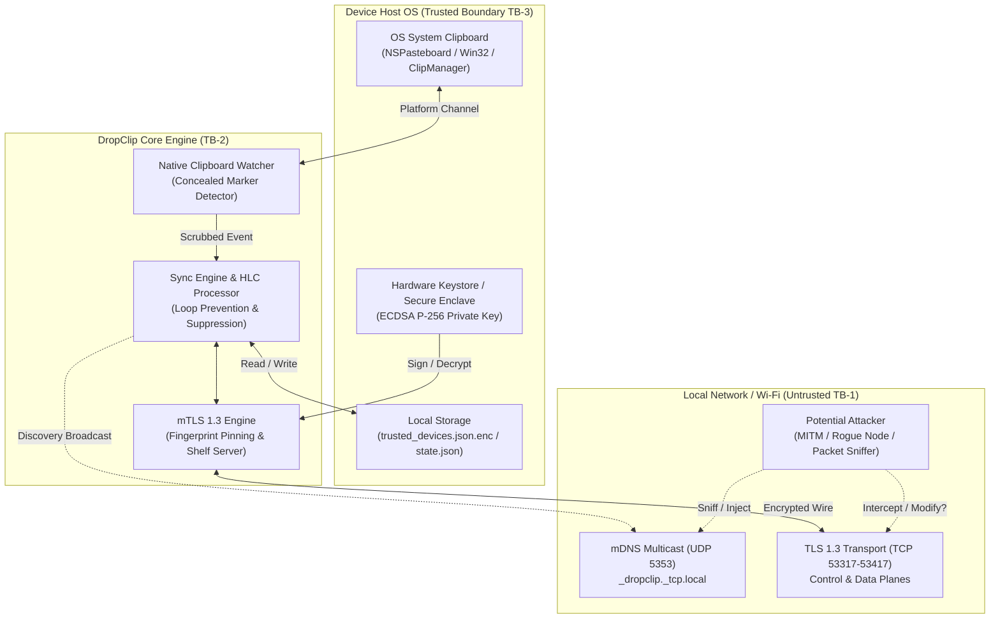
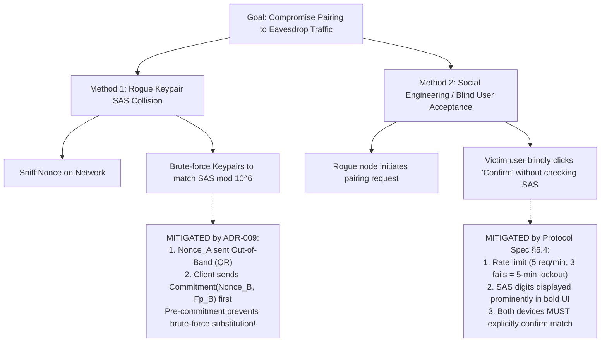
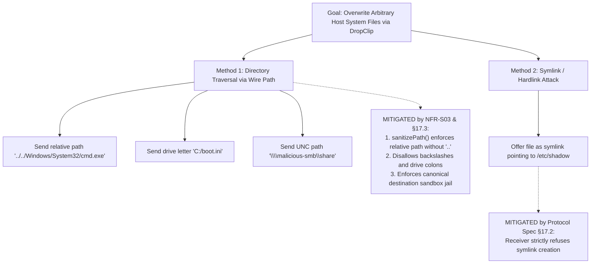

# DropClip — Threat Model, Attack Trees & Security Architecture

| รายการ | รายละเอียด |
|---|---|
| **รหัสเอกสาร** | THREAT-DC-V1.0 |
| **Document Version** | 1.0 — Realigned to SRS-DC-V1.2 & PROTO-DC-V2.0 |
| **สถานะ** | Approved Security Architecture Baseline |
| **Lead Security Architect** | นายธนกฤต บุญญาวรกุล (เจ) — Team Lead & System Architect |
| **QA & Pentest Lead** | นายปรมินทร์ มุขอาษา (ตามด) — QA & Security Engineer |
| **มาตรฐานที่อ้างอิง** | Microsoft STRIDE, OWASP Top 10, NIST SP 800-30 Rev 1, CVSS v3.1 |

---

## 1. Executive Summary & Security Objectives

**DropClip** เป็นระบบ Peer-to-Peer Cross-Platform Synchronization ที่ออกแบบภายใต้ปรัชญา **Zero-Cloud & Local-First** การส่งต่อข้อมูลคลิปบอร์ดและไฟล์ระหว่างอุปกรณ์ (macOS, Windows, Android, iOS) กระทำโดยตรงผ่านเครือข่ายท้องถิ่น (Local Area Network / Wi-Fi) โดยไม่พึ่งพาเซิร์ฟเวอร์คลาวด์หรือฐานข้อมูลภายนอก

เป้าหมายความปลอดภัยหลัก (Primary Security Objectives):
1. **Confidentiality:** ข้อมูลคลิปบอร์ด รหัสผ่าน และไฟล์ของผู้ใช้ต้องไม่รั่วไหลสู่เครือข่าย หรือถูกแอบดักจับ (Eavesdropping) โดยผู้ไม่หวังดีในวง LAN เดียวกัน (เช่น Free Public Wi-Fi)
2. **Integrity:** ข้อมูลที่ส่งข้ามอุปกรณ์ต้องไม่ถูกดัดแปลง (Tampering) และอุปกรณ์รับต้องไม่ถูกล่อลวงให้เขียนทับไฟล์ระบบผ่าน Path Traversal Attacks
3. **Mutual Authenticity:** การเชื่อมต่อต้องกระทำระหว่างอุปกรณ์ที่ผ่านการจับคู่ (Explicit Cryptographic Pairing) และยืนยันตัวตนสองทิศทาง (Mutual TLS) เท่านั้น ป้องกัน Active Man-in-the-Middle (MITM) 100%
4. **Availability & Resilience:** อุปกรณ์ต้องทนทานต่อการโจมตีแบบ DoS, Memory Flooding, และการส่งคล็อกปั่นป่วน (Clock Manipulation)
5. **Instant Cluster Revocation:** เมื่ออุปกรณ์สูญหายหรือถูกเพิกถอน คำสั่งตัดสิทธิ์ต้องกระจายและมีผลทั่วทั้งคลัสเตอร์โดยสมบูรณ์

---

## 2. System Decomposition & Data Flow Diagrams (DFD)

### 2.1 Trust Boundaries (ขอบเขตความเชื่อถือ)

ระบบ DropClip ประกอบด้วย 3 Trust Boundaries หลัก:

- **TB-1: Network / Transport Boundary:** ขอบเขตระหว่าง Network Interface (Wi-Fi/LAN) กับ Transport Engine — สภาพแวดล้อมเครือข่ายถือเป็น **Untrusted** (อาจมีผู้โจมตีทำ ARP Spoofing หรือ Packet Sniffing ได้ตลอดเวลา)
- **TB-2: Inter-Process / Platform Channel Boundary:** ขอบเขตระหว่าง Flutter Dart VM กับ Native Code (Swift / C++ / Kotlin) หรือ App Extension (iOS Share Sheet Extension)
- **TB-3: Host Storage & Hardware Keystore Boundary:** ขอบเขตระหว่าง Local File System กับ Hardware-backed Key Storage (Apple Keychain / Windows DPAPI / Android Keystore)

---

## 3. Asset Inventory & Classification

| รหัสสินทรัพย์ | ชื่อสินทรัพย์ (Asset Name) | ระดับความสำคัญ | CIA Triad | คำอธิบายและผลกระทบหากถูกโจมตี |
|:---:|---|:---:|:---:|---|
| **A-01** | **ECDSA P-256 Private Key** | **Critical** | C, I | กุญแจอัตลักษณ์ประจำอุปกรณ์ จัดเก็บใน Secure Storage หากหลุด ผู้โจมตีสามารถปลอมตัวเป็นอุปกรณ์นั้นได้สมบูรณ์ |
| **A-02** | **Clipboard Content (Text, Image)** | **High** | C | เนื้อหาคลิปบอร์ดของผู้ใช้ (อาจมีข้อความส่วนตัว, เลขบัญชี, บัตรเครดิต) หากรั่วไหลจะกระทบความเป็นส่วนตัว |
| **A-03** | **Sensitive / Password Markers** | **Critical** | C | ข้อมูลที่คัดลอกจาก Password Manager (1Password, Bitwarden) **ต้องไม่ถูกส่งออกนอกเครื่องเด็ดขาด** |
| **A-04** | **Incoming User Files** | **High** | I, A | ไฟล์ที่รับมาจากเครื่องอื่น ต้องตรวจสอบความถูกต้องครบถ้วน และไม่ให้เขียนทับไฟล์ภายนอกปลายทาง |
| **A-05** | **Trusted Device Store (`trusted_devices.json.enc`)** | **High** | I, C | รายการคู่กุญแจและ Fingerprint ของเครื่องที่อนุญาต หากถูกแก้ไข ผู้โจมตีจะสามารถฉีดกุญแจแปลกปลอมเข้าสู่ระบบได้ |
| **A-06** | **Hybrid Logical Clock (`state.json`)** | **Medium** | I | ค่า HLC สถานะคล็อก หากถูกปั่นป่วนอาจทำให้ข้อมูลใหม่ถูกปฏิเสธ (Stale drop) |

---

## 4. Threat Actor Profiles & Threat Modeling Assumptions

1. **Internal Passive Attacker (LAN Sniffer):**
   - *ความสามารถ:* ดักฟัง Packet ทุกชนิดบนวง Wi-Fi เดียวกัน (Promiscuous mode), มองเห็น mDNS multicast และ TCP traffic
   - *ข้อจำกัด:* ไม่สามารถเจาะทะลุเข้ารหัส TLS 1.3 โดยไม่มี Private Key
2. **Internal Active Attacker (Man-in-the-Middle):**
   - *ความสามารถ:* ทำ ARP Cache Poisoning, DNS Spoofing, ปลอมแปลง mDNS Responder, แก้ไข/ตัดต่อ Packet ระหว่างทาง, สุ่มสร้าง Keypair ปลอม
   - *ข้อจำกัด:* ไม่สามารถปลอมแปลง Out-of-Band Channel (หน้าจอแสดงผล QR Code / PIN)
3. **Malicious Local Application (Co-located Malware):**
   - *ความสามารถ:* แอปพลิเคชันอื่นบนเครื่องผู้ใช้ที่พยายามดักฟังพอร์ต TCP ในเครื่อง, พยายามอ่านโฟลเดอร์ไฟล์ข้อมูลของ DropClip
   - *ข้อจำกัด:* ถูกกักกันโดย OS App Sandbox / User Permission (ไม่ได้รับสิทธิ์ Root/Administrator)
4. **Stolen / Compromised Peer Node:**
   - *ความสามารถ:* โน้ตบุ๊กหรือมือถือที่เคย Pair ถูกขโมย ผู้โจมตีครอบครองเครื่องที่ได้รับอนุญาตในคลัสเตอร์
   - *เป้าหมายการป้องกัน:* ผู้ใช้สั่ง Revoke จากเครื่องที่เหลือ แล้วคำสั่งต้องตัดสิทธิ์เครื่องที่หายทั่วทั้งระบบ

---

## 5. STRIDE Threat Analysis by Component

### 5.1 S — Spoofing Identity (การสวมรอย)

| Threat ID | Threat Scenario | Attack Vector | Component | Impact | Severity | Mitigation Strategy |
|:---:|---|---|---|---|:---:|---|
| **T-S01** | Rogue mDNS Peer Spoofing | ผู้โจมตีประกาศ `_dropclip._tcp.local` ปลอม เพื่อล่อให้เหยื่อส่งข้อมูลหา | Discovery Engine | ปานกลาง | Medium | **Fingerprint Pinning (§4.4):** แอปปฏิเสธการเชื่อมต่อทุกชนิดจากโหนดที่ Fingerprint ไม่อยู่ใน Trusted Store ด้วย `403 E_NOT_PAIRED` |
| **T-S02** | Active MITM on Pairing (SAS Collision Attack) | ผู้โจมตีอยู่คั่นกลางขณะ Pair สุ่ม Keypair จำนวนมากจนได้ SAS 6 หลักตรงกับเหยื่อ | Pairing Protocol | วิกฤติ | **High (CVSS 7.5)** | **Commit-then-Reveal SAS & OOB QR Nonce (ADR-009):** Client ส่ง Commitment $C_B = H(\text{nonce}_B \parallel \text{fp}_B)$ ล่วงหน้า และ Nonce A ส่งผ่าน QR หน้าจอเท่านั้น ผู้โจมตีไม่สามารถสุ่มแก้ Keypair ได้อีกต่อไป |
| **T-S03** | Compromised Peer Replay Identity | ผู้โจมตีที่ถูก Revoke พยายาม Replay Certificate เดิม | Transport Layer | สูง | High | **Signed Cluster Revocation (§13):** โหนดทุกเครื่องลบ Fingerprint ออกจาก Trusted Store ทันทีที่ได้รับ Token |

---

### 5.2 T — Tampering with Data (การดัดแปลงข้อมูล)

| Threat ID | Threat Scenario | Attack Vector | Component | Impact | Severity | Mitigation Strategy |
|:---:|---|---|---|---|:---:|---|
| **T-T01** | Wire Payload Tampering | ผู้โจมตีแก้ไขข้อมูลคลิปบอร์ดหรือไฟล์ขณะส่งผ่านสาย LAN | Transport Plane | สูง | High | **TLS 1.3 AEAD:** ข้อมูลทุกไบต์ถูกเข้ารหัสและทำ Authenticated Encryption (`AES-128-GCM` / `CHACHA20-POLY1305`) |
| **T-T02** | Path Traversal File Overwrite (Zip-Slip / Directory Traversal) | ผู้โจมตีส่ง `file.offer` ที่มี `path: "../../../Windows/System32/evil.dll"` หรือ `C:/` เพื่อเขียนทับไฟล์ระบบ | File Transfer Engine | หายนะ | **Critical (CVSS 9.8)** | **Strict Path Sanitizer (NFR-S03, §17.3):** บล็อก 12 Attack Vectors (V1–V12), บังคับ Relative Path, ห้าม Backslash, ลบ Drive Letter, และ Canonicalize ใต้ Destination Sandbox เท่านั้น |
| **T-T03** | Partial Chunk Corruption in Resumable Transfer | การสตรีมหลุดกลางคัน ผู้โจมตีฉีด Chunk ปลอมเข้า `.part` file | Resumable Transfer | ปานกลาง | Medium | **64 MiB Checkpoint Hashing (§12.4):** ทุก 64 MiB คำนวณ SHA-256 บันทึกใน Sidecar `.part.json` และ Final Hash Checksum ก่อนเปลี่ยนชื่อไฟล์จริง |

---

### 5.3 R — Repudiation (การปฏิเสธความรับผิดชอบ)

| Threat ID | Threat Scenario | Attack Vector | Component | Impact | Severity | Mitigation Strategy |
|:---:|---|---|---|---|:---:|---|
| **T-R01** | Forged Cluster Revocation Message | ผู้โจมตีฉีดคำสั่งเพิกถอนโหนดอื่นในคลัสเตอร์ เพื่อทำลายการเชื่อมต่อของระบบ | Control Plane | สูง | High | **Signed Revocation Token (§13.2):** คำสั่ง `cluster.revocation` ต้องแนบ `RevocationBroadcastToken` ที่ลงนามด้วย ECDSA P-256 ของโหนดต้นทางที่ได้รับความเชื่อถือเท่านั้น |
| **T-R02** | Stale Clock History Manipulation | ผู้โจมตีส่ง event เก่ากลับมาเพื่อทำให้ Sync เกิดความสับสน | Sync Engine | ต่ำ | Low | **Hybrid Logical Clock & Message Deduplication (§10):** บันทึก `_seenMsgIds` LRU(200) และ LWW rule |

---

### 5.4 I — Information Disclosure (การรั่วไหลของข้อมูลลับ)

| Threat ID | Threat Scenario | Attack Vector | Component | Impact | Severity | Mitigation Strategy |
|:---:|---|---|---|---|:---:|---|
| **T-I01** | Password Manager Clipboard Leakage | ผู้ใช้ Copy รหัสผ่านจาก 1Password, Bitwarden แล้วระบบซิงก์รหัสผ่านข้ามเครือข่าย | Clipboard Watcher | หายนะ | **Critical (CVSS 8.8)** | **100% Recognized Sensitive Marker Filtering (NFR-S04, §10.4):** Native hooks ดักจับ `org.nspasteboard.ConcealedType`, `ExcludeClipboardContentFromMonitorProcessing`, `EXTRA_IS_SENSITIVE` สกัดกั้นก่อนอ่าน payload 100% |
| **T-I02** | Private Key Exfiltration from Disk | มัลแวร์ในเครื่องพยายามอ่าน Private Key จาก App Directory | Storage Layer | วิกฤติ | **High (CVSS 7.8)** | **OS Secure Hardware Storage (NFR-S02, §4.2):** Private key เก็บใน macOS Keychain, Windows DPAPI/CNG, Android Keystore โดยไม่มี Plaintext บนดิสก์เด็ดขาด |
| **T-I03** | Sensitive Data Leakage in Logs / Crash Dumps | บันทึก Log หรือ Error dump ติดข้อมูลคลิปบอร์ดหรือ Private key | Telemetry / Logger | สูง | High | **Structured Logging Scrubber (NFR-S02, T0.3):** กลไก Scrubber ตรวจสอบและตัด Private Key, Password, และ Full Clipboard Payload ออกจาก Log 100% |

---

### 5.5 D — Denial of Service (การทำให้ระบบไม่พร้อมใช้งาน)

| Threat ID | Threat Scenario | Attack Vector | Component | Impact | Severity | Mitigation Strategy |
|:---:|---|---|---|---|:---:|---|
| **T-D01** | Memory Flooding via Giant Clipboard Payload | โหนดส่งข้อความคลิปบอร์ดขนาด 500 MB เข้ามาทาง WebSocket Control Plane | Control Plane | สูง | High | **Strict Size Routing (§10.2):** ข้อมูลคลิปบอร์ดจำกัดไม่เกิน 32 MB และบน Control Plane บล็อกทันทีถ้าเกิน 64 KiB (`E_PAYLOAD_TOO_LARGE`) |
| **T-D02** | Disk Exhaustion Attack via Unsolicited Files | โหนดส่งไฟล์ขนาดใหญ่มาเต็มดิสก์ของเหยื่อ | File Receiver | สูง | High | **Explicit User Acceptance & Pre-flight Disk Check (FR-08):** ต้องกดยอมรับ `file.offer` (ยกเว้น Auto-accept ใน Trusted Zone) พร้อมตรวจพื้นที่ดิสก์ก่อนรับ หากไม่พอส่ง `507 E_DISK_FULL` |
| **T-D03** | Future Clock Drift Attack (LWW Hijack) | โหนดตั้งเวลาล่วงหน้าไปปี 2035 เพื่อให้ข้อมูลของตนชนะ LWW ตลอดกาล | HLC Engine | สูง | High | **Bounded Clock Drift Enforcement (§10.3):** หาก remote HLC $l - \text{nowMs} > 60,000\text{ ms}$ (60 วินาที) ระบบปฏิเสธข้อความทันที (`clipboard.clock_drift_exceeded`) |

---

### 5.6 E — Elevation of Privilege (การยกระดับสิทธิ์)

| Threat ID | Threat Scenario | Attack Vector | Component | Impact | Severity | Mitigation Strategy |
|:---:|---|---|---|---|:---:|---|
| **T-E01** | Arbitrary Code Execution via Transferred File | ผู้ส่งส่งไฟล์ `.exe`, `.sh`, `.app` มา แล้วระบบเผลอรันไฟล์นั้นอัตโนมัติ | Desktop Inbound Engine | หายนะ | **Critical (CVSS 9.8)** | **No Auto-Execution & macOS Quarantine (NFR-S03, §17.2):** ห้ามรันไฟล์ที่รับมาอัตโนมัติเด็ดขาด และไฟล์ที่ลงบน macOS ต้องแนบ `com.apple.quarantine` เสมอ |
| **T-E02** | iOS Jetsam Limit DoS in Share Extension | การส่งไฟล์ขนาดใหญ่ใน Share Extension ทำให้แอปโดน OS ฆ่า | iOS Native Extension | ปานกลาง | Medium | **Background URLSession (ADR-007, T3.2):** สตรีมผ่าน background daemon ของ OS รักษาระดับ Peak RAM < 30 MB |

---

## 6. Attack Trees (แบบจำลองโครงสร้างการโจมตี)

### 6.1 Attack Tree 1: Man-in-the-Middle on Pairing Handshake

### 6.2 Attack Tree 2: Unauthorized File System Ingress / Path Traversal

---

## 7. Quantitative CVSS v3.1 Risk Assessment

| Threat Identifier | Threat Description | CVSS v3.1 Vector String | Base Score | Severity | Status |
|---|---|---|:---:|:---:|:---:|
| **T-T02** | Path Traversal File Overwrite | `CVSS:3.1/AV:A/AC:L/PR:N/UI:N/S:C/C:H/I:H/A:H` | **9.6** | **Critical** | Mitigated |
| **T-E01** | Arbitrary Code Execution on Receipt | `CVSS:3.1/AV:A/AC:L/PR:N/UI:R/S:U/C:H/I:H/A:H` | **8.0** | **High** | Mitigated |
| **T-I01** | Password Manager Clipboard Leak | `CVSS:3.1/AV:L/AC:L/PR:N/UI:N/S:U/C:H/I:N/A:N` | **6.2** | **Medium** | Mitigated |
| **T-S02** | Active MITM on Pairing (Pre-ADR-009) | `CVSS:3.1/AV:A/AC:H/PR:N/UI:R/S:U/C:H/I:H/A:N` | **6.8** | **Medium** | Mitigated |
| **T-D03** | Clock Drift Hijack of LWW | `CVSS:3.1/AV:A/AC:L/PR:N/UI:N/S:U/C:N/I:L/A:H` | **7.1** | **High** | Mitigated |
| **T-R01** | Unauthenticated Revocation Spoofing | `CVSS:3.1/AV:A/AC:L/PR:N/UI:N/S:U/C:N/I:H/A:H` | **8.1** | **High** | Mitigated |

---

## 8. Security Verification & Audit Plan

ความปลอดภัยของระบบ DropClip จะได้รับการตรวจสอบอย่างเป็นทางการใน 2 ขั้นตอนสำคัญตาม Playbook:
1. **Phase 1 Exit Review (`GATE-1`):** Desktop Security Audit ตรวจสอบ Certificate Pinning, Revocation Broadcast < 2s, 100% Recognized Sensitive Marker Filtering, และ Path Traversal 12/12 Attack Vectors
2. **Phase 4 Hardening (`T4.2`):** Comprehensive Security Audit & Mobile Penetration Testing ตรวจสอบ Fuzzing 100,000 requests, Log Scrubber Verification, และ Third-party Penetration Testing 2 วัน

