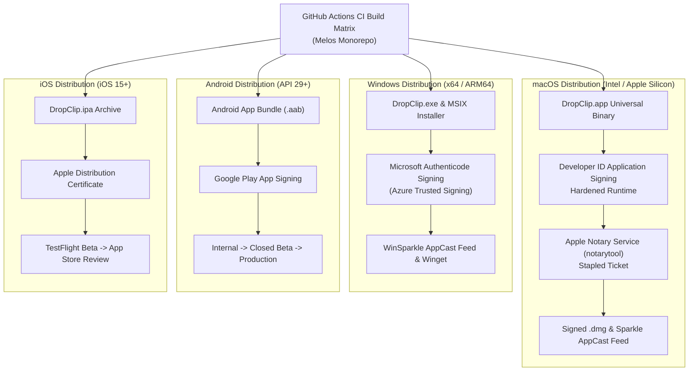

# DropClip — Release, Distribution & Lifecycle Update Plan

| รายการ | รายละเอียด |
|---|---|
| **รหัสเอกสาร** | RELEASE-DC-V1.0 |
| **Document Version** | 1.0 — Realigned to SRS-DC-V1.2 & PROTO-DC-V2.0 |
| **สถานะ** | Draft / Under Review (ทีมจัดทำ — ยังไม่ผ่านการอนุมัติจากผู้ประเมิน) |
| **Release Manager & Lead** | นายธนกฤต บุญญาวรกุล (เจ) — Team Lead & Architect |
| **Mobile Release Engineer** | นายเกื้ออนันต์ พวงนิลน้อย (เกื้อ) — Mobile Client Developer |
| **QA & Verification Lead** | นายปรมินทร์ มุขอาษา (ตามด) — QA & Performance Engineer |

---

## 1. Release Strategy & Versioning Scheme

DropClip ปฏิบัติตามมาตรฐาน **Semantic Versioning 2.0.0 (`MAJOR.MINOR.PATCH`)**:

- **MAJOR (vX.0.0):** การเปลี่ยนแปลงที่เข้ากันไม่ได้ในระดับโปรโตคอลการสื่อสาร (Breaking Protocol Changes) เช่น การเปลี่ยนรูปแบบ Wire Envelope หรือกลไก mTLS ที่ต้องจับคู่ใหม่
- **MINOR (v1.X.0):** การเพิ่มฟีเจอร์ใหม่ที่ยังคงเข้ากันได้กับโปรโตคอลเดิม (Backward-Compatible Feature Additions) เช่น การรองรับชนิดไฟล์ใหม่, การปรับปรุง UI, การเพิ่ม Widget
- **PATCH (v1.0.X):** การแก้ไขข้อผิดพลาดหรือปรับปรุงประสิทธิภาพที่ไม่มีผลต่อสัญญาระดับ API หรือ Wire Protocol (Backward-Compatible Bug Fixes)

---

## 2. Cluster Compatibility & Mixed-Version Protocol Negotiation

เนื่องจาก DropClip ทำงานแบบ Peer-to-Peer กระจายศูนย์ (Decentralized Mesh) โดยไม่มีเซิร์ฟเวอร์กลางคอยบังคับการอัปเดตพร้อมกัน อุปกรณ์ในวง LAN จึงอาจมีเวอร์ชันของซอฟต์แวร์ไม่ตรงกันในช่วงเปลี่ยนผ่าน (Mixed-Version Cluster):

### 2.1 Negotiation Flow via Control Plane (`hello` message)

เมื่ออุปกรณ์เปิดการเชื่อมต่อ WebSocket over mTLS:
1. ทั้งสองฝั่งส่งข้อความ `hello` ระบุ:
   - `v`: Protocol Wire Version ปัจจุบันของตน (เช่น `2`)
   - `min_supported_v`: Protocol Version ต่ำสุดที่ยังรองรับได้ (เช่น `1`)
   - `app_version`: รหัสเวอร์ชันของแอปพลิเคชัน (เช่น `"1.2.0"`)
2. กฎการตกลงเวอร์ชัน (Version Agreement Rules):
   - หาก $\text{Peer.v} \ge \text{Local.min\_supported\_v}$ และ $\text{Local.v} \ge \text{Peer.min\_supported\_v}$ → การสื่อสารดำเนินต่อไปได้ โดยใช้โปรโตคอลเวอร์ชันต่ำกว่าในคู่นั้น
   - หากไม่ตรงกัน → ปิด Socket ด้วยรหัส `4003` พร้อมข้อความแจ้งเตือน `E_UNSUPPORTED_VERSION`
3. Forward Compatibility Rule:
   - เมื่อโหนดได้รับ JSON Envelope ที่มี Field ที่ตนไม่รู้จัก (Unknown Fields) → **MUST ละเว้น Field นั้นอย่างปลอดภัยโดยไม่โยนข้อยกเว้น (Gracefully Ignore)**

---

## 3. Multi-Platform Packaging & Distribution Pipeline

### 3.1 macOS Platform Deployment
- **Packaging:** Standalone Universal 2 Binary (arm64 + x86_64) บรรจุใน `.dmg`
- **Security Entitlements:**
  - `com.apple.security.network.server` (Local Port Binding)
  - `com.apple.security.network.client` (Outbound Transport)
  - `com.apple.security.application-groups` (`$(TeamID).com.dropclip.shared`)
- **Code Signing & Notarization:** ลงนามด้วย Apple Developer ID Application พร้อมแนบ Timestamp จาก Apple Timestamp Server และทำ Notarization ผ่าน `xcrun notarytool`
- **Auto-Update:** ขับเคลื่อนด้วย **Sparkle Framework 2.x** ผ่าน HTTPS AppCast XML Feed พร้อมการตรวจสอบลายเซ็น Ed25519 ของไฟล์อัปเดต

### 3.2 Windows Platform Deployment
- **Packaging:** Windows MSIX Package และ Standalone NSIS Executable Installer (.exe)
- **Code Signing:** ลงนามด้วย Microsoft Authenticode Certificate เพื่อป้องกันคำเตือน Windows SmartScreen Block
  - *Primary Signing Architecture (Production/Enterprise):* Hardware Token EV / Standard Code Signing (DigiCert / Sectigo) ผ่าน SignTool สำหรับการพัฒนาและ Release ของนิติบุคคล/นักพัฒนาในเชิงพาณิชย์
  - *Cloud Signing Alternative:* Azure Trusted Signing (หากมี Azure Tenant องค์กรที่ผ่านการรับรอง)
  - *Open-Source & Student Project Pathway (บริบทโครงงานการศึกษา):* สำหรับโครงงานนักศึกษา/โอเพนซอร์สที่ยังไม่มีใบรับรองเชิงพาณิชย์ (EV Certificate ซึ่งมีค่าใช้จ่ายสูง $300+/ปี) ระบบจะจัดทำ GitHub Releases พร้อมเผยแพร่ SHA-256 Checksums อย่างเป็นทางการ และระบุคำแนะนำแก่ผู้ใช้ในการกดยืนยันผ่าน Windows SmartScreen ("More info" → "Run anyway") รวมถึงรองรับการ Build ติดตั้งเองจากซอร์สโค้ด และการลงนามด้วย Self-Signed Certificate ที่ติดตั้งใน Root Certificate Store ของเครื่องทดสอบ
- **In-App Auto-Update:** ขับเคลื่อนด้วย **WinSparkle Framework** ผ่าน HTTPS AppCast XML Feed พร้อมตรวจสอบ SHA-256 Checksum และ Authenticode Signature
- **Package Distribution Channel:** เผยแพร่ผ่าน Windows Package Manager Community Repository (`winget install DropClip`) ควบคู่กับ GitHub Releases (เป็นช่องทางติดตั้งเสริม ไม่ใช่ตัวขับเคลื่อน In-App Update หลัก)

### 3.3 Android Platform Deployment
- **Packaging:** Android App Bundle (`.aab`) พร้อม ProGuard/R8 Obfuscation
- **Permissions:**
  - `POST_NOTIFICATIONS` (Android 13+)
  - `FOREGROUND_SERVICE` พร้อม `FOREGROUND_SERVICE_CONNECTED_DEVICE` (Android 14+)
  - `ACCESS_WIFI_STATE` & `CHANGE_WIFI_MULTICAST_STATE` (mDNS Multicast Lock)
- **Deployment Track:** เผยแพร่ผ่าน Google Play Console (Internal Testing 20 เครื่อง → Closed Testing → Production)

### 3.4 iOS Platform Deployment
- **Packaging:** iOS App Archive (`.ipa`) ควบคู่กับ Share Extension Target
- **App Groups:** `group.com.dropclip.shared`
- **Deployment Track:** เผยแพร่ผ่าน Apple TestFlight สำหรับ Dogfooding และยื่นขออนุมัติผ่าน Apple App Store Review
- **Phased Release for Automatic Updates:** เปิดใช้งาน Apple Phased Release แบบ 7 วัน เพื่อกระจายความเสี่ยง (Day 1: 1%, Day 2: 2%, Day 3: 5%, Day 4: 10%, Day 5: 20%, Day 6: 50%, Day 7: 100%) พร้อมสิทธิ์ในการหยุดพัก (Pause) ชั่วคราวได้ตลอดเวลาหากพบปัญหาวิกฤติ

---

## 4. Roll-Forward Strategy & Emergency Triage Procedure

เนื่องจากกลไก Auto-Update ของ App Store, Google Play, Sparkle, และ WinSparkle ไม่อนุญาตหรือไม่อำนวยความสะดวกในการ Downgrade ข้ามเวอร์ชันที่มี Version Number ต่ำกว่าเดิม DropClip จึงใช้ยุทธศาสตร์ **Roll-Forward Architecture** ในการรับมือข้อผิดพลาดร้ายแรง (Defect Remediation):

### 4.1 Triage Severity Levels & SLA
- **P0 — Emergency Blocker:** ปัญหาด้านความปลอดภัย, ข้อมูลคลิปบอร์ดรั่วไหล, หรือแอป Crash ต่อเนื่องเมื่อเปิดใช้งาน
  - *Response Time:* ยืนยันปัญหาภายใน **< 24 ชั่วโมง** และออก Hotfix Build ทันที
- **P1 — High Priority:** ฟังก์ชันหลักใช้งานไม่ได้ (เช่น mDNS หาเครื่องไม่เจอ, ส่งไฟล์ขนาดใหญ่ไม่ผ่าน)
  - *Response Time:* ต้องออก Patch ภายใน **< 72 ชั่วโมง**

### 4.2 Roll-Forward Release Execution
- **Desktop (macOS / Windows):** สร้างและลงนาม Release ใหม่ทันทีโดยปรับเพิ่ม Patch Version (เช่น `v1.0.2` ซึ่งบรรจุโค้ดฐานเดิมที่เสถียรของ `v1.0.0` หรือ Hotfix เฉพาะจุด) เผยแพร่ผ่าน AppCast XML Feed พร้อมตั้งค่า `sparkle:criticalUpdate="true"`
- **Android (Google Play):** หยุดการกระจายของ Staged Rollout ปัจจุบันทันที แล้วอัปโหลด AAB ใหม่ที่มี `versionCode` สูงกว่าเดิมเพื่อแทนที่ในสายการผลิต
- **iOS (App Store):** กด Pause Phased Release ทันที และส่ง Build ใหม่พร้อมยื่นคำขอ **Expedited Review** กับ Apple App Review Team เพื่อขออนุมัติเผยแพร่ฉุกเฉินภายใน 24 ชั่วโมง

### 4.3 Storage Schema Versioning & Backward Compatibility
เพื่อรับประกันว่าการ Roll-Forward หรือการสลับเวอร์ชันจะไม่ทำลายข้อมูลผู้ใช้:
- ไฟล์บันทึกข้อมูลถาวรทั้งหมด (`trusted_devices.json.enc`, `revoked_tombstones.json`, `state.json`) ต้องมีฟิลด์ `schema_version: 1`
- การอัปเกรดต้องมีตัวแปลงข้อมูล (Migration Handler) ที่ปลอดภัย และรักษาความเข้ากันได้แบบย้อนหลัง (Backward Compatibility)
- **Zero-Loss Guarantee:** ห้ามลบ Trusted Device Store หรือ key ใน OS Secure Storage เด็ดขาด ผู้ใช้ไม่ต้องจับคู่อุปกรณ์ใหม่หลังการอัปเดต

---

## 5. Regulatory, Privacy & Store Compliance

### 5.1 Thailand PDPA & International Privacy Standards
- **Zero-Cloud Architecture:** DropClip ไม่มีฐานข้อมูลคลาวด์ ไม่มีการจัดเก็บข้อมูลส่วนบุคคล (PII) ของผู้ใช้นอกอุปกรณ์ของตนเอง
- **100% On-Device Processing:** ข้อมูลคลิปบอร์ดและไฟล์เดินทางผ่านเครือข่าย Wi-Fi ท้องถิ่นระหว่างอุปกรณ์ที่จับคู่เท่านั้น
- **Telemetry Anonymization:** ระบบไม่ส่งข้อมูลการใช้งานภายนอก (No Telemetry / No Analytics SDKs)

### 5.2 Apple App Store Guidelines Alignment
- **Local Network Usage:** ระบุ `NSLocalNetworkUsageDescription` ชัดเจนใน `Info.plist`:
  > "DropClip uses your local network to discover and securely synchronize clipboards and files with your paired devices."
- **Bonjour Services:** ประกาศ `_dropclip._tcp` ใน `NSBonjourServices`
- **Data Privacy Nutrition Labels:** ประกาศว่า "Data Not Collected" สำหรับทุกหมวดหมู่ข้อมูล

### 5.3 Google Play Store Policy Alignment
- **Foreground Service Policy:** ชี้แจงการใช้งาน Foreground Service ชนิด `connectedDevice` ต่อ Google Play Team ว่ามีความจำเป็นอย่างยิ่งสำหรับการรักษาการเชื่อมต่อ Socket สองทิศทางกับอุปกรณ์ที่จับคู่ในวง LAN เพื่อการรับส่งข้อมูลคลิปบอร์ดแบบเรียลไทม์
- **Scoped Storage:** ปฏิบัติตามมาตรฐาน Scoped Storage (บันทึกรูปภาพ/วิดีโอผ่าน `MediaStore` และเอกสารลง Downloads) โดยไม่ต้องขอสิทธิ์อันตราย `MANAGE_EXTERNAL_STORAGE`

### 5.4 Export Diagnostic Bundle (Zero-Cloud Incident Triage)
เนื่องจาก DropClip ยึดถือหลัก Zero-Cloud จึงไม่มีระบบ Crash Analytics หรือ Telemetry อัตโนมัติส่งกลับเซิร์ฟเวอร์ การวิเคราะห์และแก้ไขปัญหา P0 จากภาคสนามจึงอาศัยกลไก:
- **User-Initiated Export:** ผู้ใช้สามารถกดปุ่ม "Export Diagnostic Bundle" ใน Settings หน้าจอแอปพลิเคชัน
- **Scrubbed Data Only:** บันทึกเฉพาะ Log ที่ผ่าน Scrubber แล้ว (`app.log`), ข้อมูลเวอร์ชันระบบปฏิบัติการ, สถานะเชื่อมต่อ mDNS/TCP, และ Masked Local Subnet โดย**ตัด Private Key, Certificate, ข้อมูลคลิปบอร์ด และเนื้อหาไฟล์ออก 100%**
- ไฟล์จะถูกส่งออกเป็น `.zip` ให้ผู้ใช้แนบส่งทาง GitHub Security Advisories (ถ้าเกี่ยวกับช่องโหว่) หรือ GitHub Issue ได้อย่างปลอดภัย

---

## 6. Software Bill of Materials (SBOM) & Supply Chain Security

เพื่อความปลอดภัยสูงสุดในกระบวนการผลิตซอฟต์แวร์ (Supply Chain Security):
1. **Dependency Locking:** ตรวจสอบและบันทึก Checksum ของทุก Package ใน `pubspec.lock`, `Podfile.lock`, และ Gradle Wrapper
2. **Automated Vulnerability Audit:** ตรวจสอบช่องโหว่ความปลอดภัยของ Dependencies อัตโนมัติใน CI ทุกสัปดาห์ด้วย **`osv-scanner`** (Google Open Source Vulnerabilities Scanner), `dart pub outdated`, และ GitHub Dependabot (หมายเหตุ: SDK ปัจจุบันยังไม่มีคำสั่ง `dart pub audit` ในตัว จึงใช้ `osv-scanner` เป็นเครื่องมือมาตรฐานอุตสาหกรรม)
3. **CycloneDX SBOM Generation:** ทุก Release Build ใน GitHub Actions จะส่งออกไฟล์ `sbom-dropclip.json` ตามมาตรฐาน CycloneDX 1.5 เพื่อให้ผู้ใช้งานและองค์กรสามารถตรวจสอบส่วนประกอบซอฟต์แวร์แบบโอเพนซอร์สได้อย่างโปร่งใส

---

## 7. Vulnerability Disclosure & Coordinated Release

DropClip ปฏิบัติตามมาตรฐาน RFC 9116 ผ่าน `/.well-known/security.txt` และช่องทางรายงานแบบลับของ GitHub:
- **Primary Intake Channel (Open-Source Project):** GitHub Security Advisories Private Vulnerability Reporting (`https://github.com/nCotista/DropClip/security/advisories`) สำหรับรับแจ้งช่องโหว่จากภายนอกอย่างปลอดภัยโดยไม่เปิดเผยสู่สาธารณะก่อนเวลา
- **Security Contact:** ยังไม่มีโดเมน/อีเมลของโครงการ — ใช้ GHSA เป็นช่องทางเดียวจนกว่าจะจดโดเมนได้
- **Coordinated Vulnerability Disclosure (CVD):** ให้เวลาทีมงาน 7 วันในการพัฒนาและปล่อย Patch ผ่าน Roll-Forward ก่อนการเปิดเผยรายละเอียดสู่สาธารณะ
